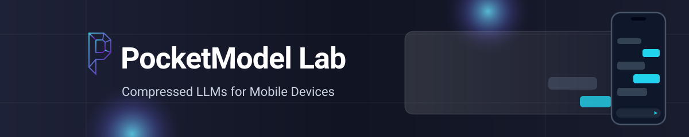
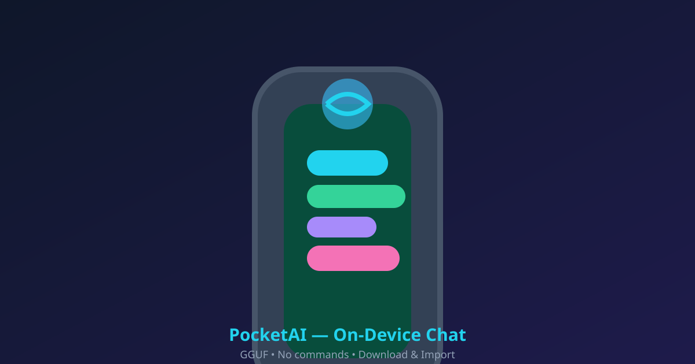

  

<h1 align="center">PocketAI</h1>

<b>Phone-ready GGUF language models — built for mobile, compressed for speed.</b>

  
  
  
  

  

---

## 📱 Choose your build by phone RAM

| Build | Phone Class | Base | Quant | Size | RAM Needed | Download |
|---|---|---|---|---|---|---|
| **PocketAI-Kilo** | Budget (2–3 GB) | Ndx-0.6B | IQ2_M | ~0.30 GB | ~2 GB | [Download ⬇️](#direct-download) |
| **PocketAI-Kilo-HD** | Low-end (2–4 GB) | Ndx-0.6B | Q3_K_M | ~0.38 GB | ~2.5 GB | [Download ⬇️](#direct-download) |
| **PocketAI-Mega** | Mid (4–6 GB) | Ndx-0.6B | Q4_K_M | ~0.44 GB | ~3 GB | [Download ⬇️](#direct-download) |
| **PocketAI-Giga** | Upper-mid (6–8 GB) | Ndx-1.7B | IQ2_M | ~0.75 GB | ~4 GB | [Download ⬇️](#direct-download) |
| **PocketAI-Giga-HD** | Flagship (8 GB+) | Ndx-1.7B | Q4_K_M | ~1.16 GB | ~5 GB | [Download ⬇️](#direct-download) |
| **PocketAI-Titan** | Emulator / PC | 27B Teacher | IQ2_M | ~10–12 GB | 12 GB+ | [HF Mirror](https://huggingface.co/junaiidshah78634/PocketModel-Lab) |

---

## 🚀 Direct Download (No commands needed)

Just tap the link on your phone — the `.gguf` file downloads directly. No terminal, no CLI.

All assets live in GitHub Release **`pocket-v1.0`**:

- [PocketAI-Kilo-Ndx-IQ2_M.gguf](https://github.com/junaidshah9826650092-cmyk/PocketModel-Lab/releases/download/pocket-v1.0/PocketAI-Kilo-Ndx-IQ2_M.gguf)
- [PocketAI-KiloHD-Ndx-Q3_K_M.gguf](https://github.com/junaidshah9826650092-cmyk/PocketModel-Lab/releases/download/pocket-v1.0/PocketAI-KiloHD-Ndx-Q3_K_M.gguf)
- [PocketAI-Mega-Ndx-Q4_K_M.gguf](https://github.com/junaidshah9826650092-cmyk/PocketModel-Lab/releases/download/pocket-v1.0/PocketAI-Mega-Ndx-Q4_K_M.gguf)
- [PocketAI-Giga-Ndx-IQ2_M.gguf](https://github.com/junaidshah9826650092-cmyk/PocketModel-Lab/releases/download/pocket-v1.0/PocketAI-Giga-Ndx-IQ2_M.gguf)
- [PocketAI-GigaHD-Ndx-Q4_K_M.gguf](https://github.com/junaidshah9826650092-cmyk/PocketModel-Lab/releases/download/pocket-v1.0/PocketAI-GigaHD-Ndx-Q4_K_M.gguf)

> **Tip:** Use `releases/latest/download/` to always get the newest build.

---

## 📲 How to run on your phone

| App | Platform | What to do |
|---|---|---|
| **PocketPal AI** | Android / iOS | Settings → Local Models → + → Load from phone → pick `.gguf` |
| **ChatterUI** | Android | Manage → Models → + → Import GGUF → Template: Qwen3 / ChatML |
| **Termux** | Android CLI | `sh scripts/fetch-model.sh kilo` (optional) — or download manually |
| **LM Studio** | Desktop | My Models → Import → select `.gguf` |
| **Ollama** | Desktop | `ollama create pocket-ai -f Modelfile.ollama` |

**Settings tip:** Context 4096 (2048 on 2–3 GB phones). Threads = your big CPU cores.

---

## 🏗️ How it’s built

1. **Source:** Qwen/Qwen3-0.6B & Qwen3-1.7B Q8_0 GGUF (bartowski)
2. **Calibration:** wikitext-2-raw validation set
3. **Compression:** llama.cpp `llama-imatrix` + `llama-quantize` (IQ2_M / Q3_K_M / Q4_K_M)
4. **Evaluation:** Perplexity vs Q8_0 baseline — retention target 90%+
5. **Packaging:** Standard GGUF — no conversion needed on-device

---

## 🏆 Founder

**Nadeem**  
- GitHub: https://github.com/junaidshah9826650092-cmyk  
- HuggingFace: https://huggingface.co/junaiidshah78634  
- Repo: https://github.com/junaidshah9826650092-cmyk/PocketModel-Lab  

---

## 📄 License

Apache-2.0 · Upstream: Qwen3 (Apache-2.0) · bartowski GGUF quants · llama.cpp (MIT)
